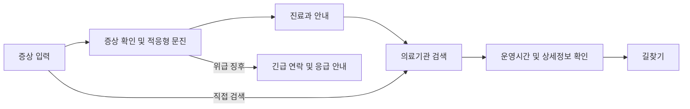
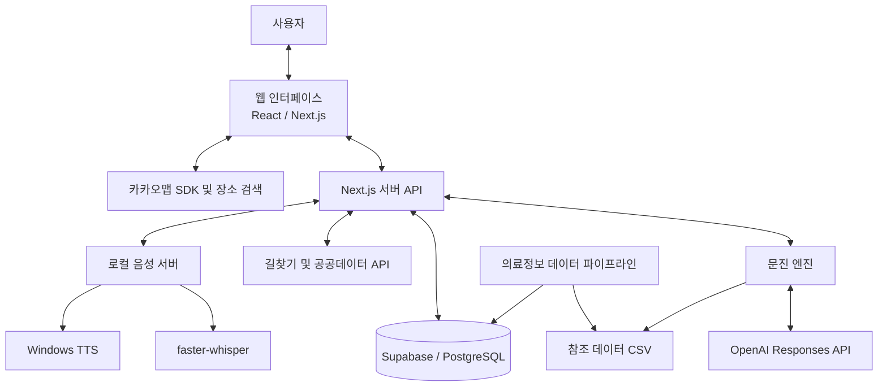

# 의료 정보 도우미 AI Agent

증상 기반 진료과 안내 및 위치 기반 의료기관 탐색 서비스


[프로젝트 소개](#프로젝트-소개) · [주요 기능](#주요-기능) · [시스템 구성](#시스템-구성) · [데이터 구축](#의료정보-데이터-구축) · [실행 방법](#실행-방법) · [팀 소개](#팀-소개)

## 프로젝트 소개

의료 정보 도우미 AI Agent는 사용자의 증상을 정리하고 적합한 진료과와 주변 의료기관을 안내하는 웹 서비스입니다.

증상에 따른 진료과 선택, 병원 및 약국 검색, 운영시간 확인, 길찾기까지 의료기관 방문에 필요한 정보를 하나의 화면에서 제공합니다. 의료정보 참조 데이터와 규칙 기반 문진 엔진을 바탕으로 자연어 입력을 처리하며, 필요한 경우 LLM을 활용합니다.

| 구분 | 내용 |
| --- | --- |
| 프로젝트 | 한림대학교 소프트웨어캡스톤디자인 |
| 팀명 | 소세지 (소중한 건강을 세심하게 지금 여기서) |
| 과제 수행 기간 | 2026.09.01 ~ 2026.12.21 |

## 주요 기능

### AI 문진 및 진료과 안내

- 자연어 증상 입력 및 표준 증상 분류
- 사용자 응답에 따른 적응형 문진과 추가 확인 질문
- 증상 및 연령, 성별 조건을 고려한 진료과 안내
- 위급 징후 확인 및 응급 도움 연결

### 의료기관 검색 및 지도

- 현재 위치, 지역명, 의료기관명 기반 병원 및 약국 검색
- 진료과목, 운영 여부, 기관 유형별 필터
- 요일별 및 공휴일 등록 운영시간 확인
- 진료과 정보와 이용 선호를 반영한 의료기관 추천 및 추천 근거 표시
- 카카오맵 연동, 마커 클러스터링, 지도 영역 재검색
- 도보, 대중교통, 자동차 길찾기와 이동거리 및 예상 소요 시간 안내
- 의료기관 상세정보, 주소 및 전화번호 복사

### 분석서 및 응급 보조

- 의료진 전달용 정보 정리 및 분석서 편집, 복사, 출력
- 건강정보 PDF 출력 및 PDF.js 기반 문서 불러오기
- 119 연락 안내, 현재 위치 및 신고 위치 확인
- 심폐소생술, 자동심장충격기, 성인 기도폐쇄, 출혈, 화상, 경련 등 응급처치 자료 및 영상 제공

### 회원 및 개인화

- Supabase Auth 기반 카카오 로그인, 가입 및 회원 탈퇴
- 건강정보 처리 및 저장 동의 관리
- 계정별 검색 설정, 즐겨찾기 및 이용 횟수 관리
- GUMO에서 착안한 행동 온톨로지 모델과 선호 기반 추천

### 다국어 및 접근성

- 한국어, 영어, 중국어 간체, 베트남어, 우즈베크어 UI
- faster-whisper 기반 한국어 음성 인식 및 Windows 음성 합성
- PC 및 모바일 반응형 레이아웃
- 라이트 모드 및 다크 모드

## 서비스 이용 흐름



## 시스템 구성



| 모듈 | 주요 역할 |
| --- | --- |
| [`frontend`](frontend/) | 사용자 인터페이스, 의료기관 검색, 지도, 길찾기, 서버 API, 인증 및 개인화 |
| [`care_engine`](care_engine/) | 증상 분류, 문진 분기, 안전 규칙, LLM 연동 및 진료과 안내 |
| [`data_pipeline`](data_pipeline/) | 의료정보 수집, 정제, 표준화, 진료과 매핑 및 DB 적재 |
| [`voice_service`](voice_service/) | 로컬 한국어 음성 인식 및 음성 합성 |

문진 엔진은 Supabase의 참조 데이터를 사용하며 조회에 실패하면 동일 버전의 시드 CSV로 전환합니다. 의료기관 검색은 카카오 API를 사용하고, 국립중앙의료원의 의료기관 정보를 대조하여 등록 운영시간을 연결합니다.

## 의료정보 데이터 구축

### 데이터 출처

| 출처 | 활용 내용 |
| --- | --- |
| ICPC-2 | 표준 증상 분류 |
| 건강보험심사평가원 | 상병마스터 및 진료과목별 상병 통계 |
| AI Hub | 헬스케어 질의응답 기반 증상 표현 및 진료과 정보 |
| 소방청 | 119구급상황관리센터 상담 매뉴얼 |
| 국립중앙의료원 | 전국 병의원 및 약국 등록 정보 |
| 한국천문연구원 | 공휴일 정보 |

### 구축 과정


ICPC-2 증상 코드 320개에서 제외 기준을 적용해 240개 후보를 선정했습니다. Claude Code와 Codex의 독립 라벨링 결과를 비교하여 표준 증상과 동의어 사전을 구축했습니다. 진료과 후보는 건강보험심사평가원 통계를 기준으로 선정하고 AI Hub 질의응답 데이터를 활용해 순서를 보완했습니다.

### 구축 결과

참조 데이터 버전: `v2.1-20261113`

| 데이터 | 수량 | 데이터 | 수량 |
| --- | ---: | --- | ---: |
| 표준 증상 | 197 | 문진 항목 | 27 |
| 증상 동의어 | 1,598 | 문진 선택지 | 89 |
| 진료과 분류 | 28 | 문진 노출 조건 | 26 |
| 119 주증상 분류 | 33 | 문진 안전 규칙 | 4 |
| 조건별 진료과 매핑 | 3,016 | 다국어 참조 텍스트 | 1,760 |

시드 데이터와 DB 적재 결과의 행 수 일치 여부, 참조 관계, 조회 권한 및 문진 안전 규칙을 검증했습니다.

상세 자료: [데이터 파이프라인](data_pipeline/README.md) / [참조 데이터 적재 검증](data_pipeline/reports/step6_load.md) / [문진 데이터 검증](data_pipeline/reports/step7_intake.md)

## 기술 스택

| 영역 | 기술 |
| --- | --- |
| Frontend | React, Next.js, JavaScript, CSS |
| Backend | Node.js, Next.js Route Handlers |
| AI | OpenAI Responses API, 규칙 기반 문진 엔진 |
| Database & Auth | PostgreSQL, Supabase, Supabase Auth, Kakao OAuth |
| Map & Public Data | Kakao Maps JavaScript SDK, Kakao Local API, 길찾기 API, 공공데이터포털 Open API |
| Data Pipeline | Python, openpyxl, ruamel.yaml, Psycopg |
| PDF | PDF.js, 브라우저 인쇄 및 PDF 출력 |
| Voice | Python, FastAPI, Uvicorn, faster-whisper, Windows SpeechSynthesizer |
| Test | Node.js test runner, jsdom |

## 프로젝트 구조

```text
CapstoneDesign/
├── frontend/
│   ├── app/              # Next.js 페이지 및 API
│   ├── components/       # React 컴포넌트
│   ├── lib/              # 서버 및 데이터 연동
│   ├── locales/          # 다국어 리소스
│   ├── supabase/         # DB 마이그레이션
│   ├── tests/            # 단위 및 회귀 테스트
│   ├── tests-next/       # Next.js 통합 테스트
│   └── docs/             # 기능별 개발 문서
├── care_engine/
│   ├── engine/           # 문진 및 안전 규칙
│   ├── llm/              # LLM 연동 및 출력 검증
│   └── eval/             # 평가 코드
├── data_pipeline/
│   ├── pipeline/         # 데이터 처리 스크립트
│   ├── config/           # 데이터 및 문진 설정
│   ├── db/               # 시드 데이터 및 마이그레이션
│   └── reports/          # 구축 및 검증 보고서
├── voice_service/        # 로컬 음성 서버
├── dev.cmd               # Windows 통합 실행 스크립트
└── README.md
```

## 실행 방법

### 1. 개발 환경

- Node.js 24.15 이상 권장 (Node.js 22 사용 시 22.22.2 이상)
- Git, npm
- Python 3 (데이터 구축), Python 3.11 x64 (Windows 음성 기능)

### 2. 설치

Windows CMD 기준:

```cmd
git clone https://github.com/sejung03/CapstoneDesign.git
cd CapstoneDesign\frontend
npm ci
copy .env.example .env.local
```

### 3. 환경변수 설정

`frontend/.env.local`에 기능별 API 키와 연결 정보를 입력합니다.

| 환경변수 | 용도 |
| --- | --- |
| `KAKAO_JAVASCRIPT_KEY` | 지도 SDK 및 장소 검색 |
| `KAKAO_REST_API_KEY` | 길찾기 API |
| `DATA_SERVICE_KEY` | 병의원 및 약국 공공데이터 |
| `NEXT_PUBLIC_SUPABASE_URL` | Supabase 프로젝트 URL |
| `NEXT_PUBLIC_SUPABASE_PUBLISHABLE_KEY` | Supabase 공개 키 |
| `APP_URL` | 앱 접속 주소 |
| `SUPABASE_SECRET_KEY` | 회원 탈퇴 처리용 서버 키 |
| `LLM_PROVIDER` | LLM 제공업체 (`openai` / `mock`) |
| `OPENAI_API_KEY` | OpenAI API 키 |
| `LLM_MODEL` | LLM 모델 설정 (선택) |

- 전체 설정: [`frontend/.env.example`](frontend/.env.example)
- 지도 및 공공데이터: [API 설정 가이드](frontend/docs/SETUP.md)
- 회원 및 DB: [Supabase 설정 가이드](frontend/docs/SUPABASE.md)
- 문진 및 LLM: [Care Engine](care_engine/README.md)

카카오 SDK 허용 도메인과 Supabase OAuth 콜백을 접속 주소에 맞게 등록합니다. 회원 기능은 관련 DB 마이그레이션을 적용한 뒤 사용합니다. 실제 API 키는 `.env.local`에 보관하고 Git 관리 대상에서 제외합니다.

### 4. 웹 서비스 실행

```cmd
npm run dev
```

접속 주소: [http://127.0.0.1:3080](http://127.0.0.1:3080)

### 5. 음성 기능 실행 (Windows)

Windows 한국어 음성을 설치한 후 저장소 루트에서 음성 서버 의존성을 설치합니다.

```cmd
cd voice_service
python -m venv .venv
.venv\Scripts\python.exe -m pip install -r requirements.txt
cd ..
dev.cmd
```

`dev.cmd`는 웹 서버(3080)와 로컬 음성 서버(3091)를 함께 실행합니다. 자세한 설치 및 모델 설정은 [음성 서버 가이드](voice_service/README.md)를 참고하세요.

### 6. 테스트 및 빌드

**Frontend** (`frontend/`)

```bash
npm run check
npm run build
npm run check:next
```

**Care Engine** (`care_engine/`)

```bash
npm test
npm run eval:paths
npm run eval:risk
```

실제 OpenAI API를 사용하는 평가는 [문진 엔진 평가 가이드](care_engine/README.md)를 참고하세요.

## 개인정보 및 이용 안내

- 건강정보 처리 및 저장 동의를 구분하고, Supabase RLS를 통해 계정별 데이터 접근을 관리합니다.
- 개인화에는 검색 설정, 즐겨찾기, 길찾기 및 전화번호 복사 등 제한된 이용 횟수를 활용합니다.
- 의료기관의 운영 여부는 등록된 시간표 기준으로 표시합니다. 방문 전 해당 기관에 운영시간을 확인하시기 바랍니다.
- 본 서비스는 진료과 및 의료기관 탐색을 위한 캡스톤디자인 프로젝트이며, 질병의 진단과 처방은 의료진의 영역입니다. 응급 상황에서는 119에 직접 연락하세요.

## 팀 소개

| 구성원 | 담당 영역 |
| --- | --- |
| 전소현 (팀 대표) | 의료정보 데이터 구축, 적응형 문진 및 진료과 안내 |
| 백강준 | 프론트엔드, 의료기관 검색, 지도, 운영시간 및 길찾기 |
| 조세정 | 회원 인증, 행동 온톨로지 및 개인화, 다국어 UI |

## 개발 문서

| 문서 | 내용 |
| --- | --- |
| [Frontend](frontend/README.md) | 웹 앱 실행 및 개발 이력 |
| [API 설정](frontend/docs/SETUP.md) | 지도, 운영시간, 길찾기 설정 |
| [Care Engine](care_engine/README.md) | 문진 엔진, LLM 및 평가 |
| [Data Pipeline](data_pipeline/README.md) | 의료정보 구축 과정 및 검증 |
| [Supabase](frontend/docs/SUPABASE.md) | 인증 및 DB 연결 |
| [Behavior Ontology](frontend/docs/BEHAVIOR_ONTOLOGY.md) | 행동 모델 및 개인화 규칙 |
| [회원 및 개인화 연동](frontend/docs/TEAM3_INTEGRATION.md) | 인증과 개인화 API 연동 |
| [I18N](frontend/docs/I18N.md) | 다국어 리소스 관리 |
| [Voice Service](voice_service/README.md) | 로컬 한국어 음성 입출력 |
